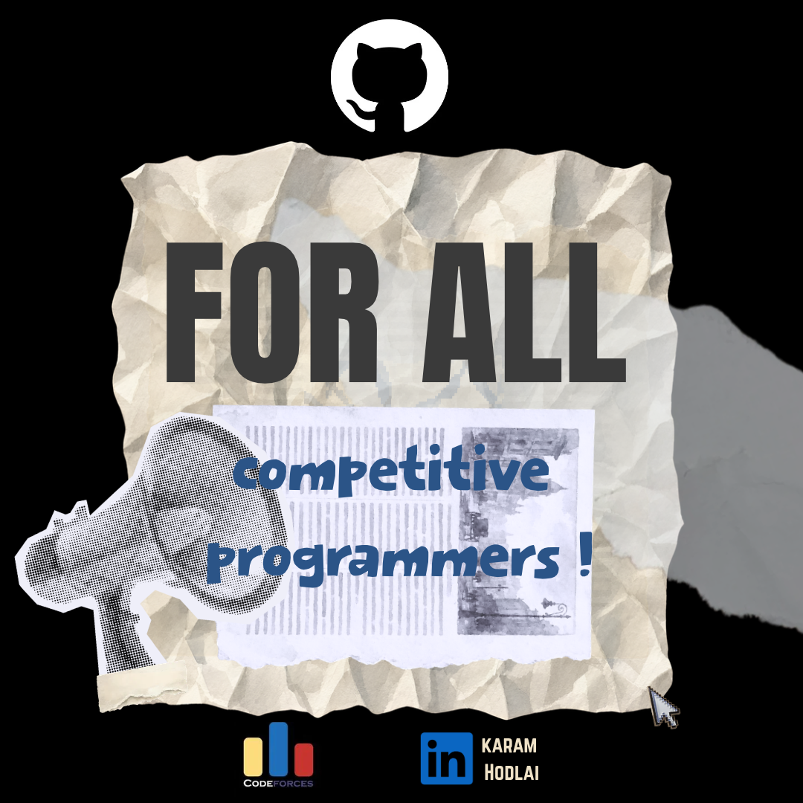

# FOR ALL COMPETITIVE PROGRAMMERS👨🏻‍💻👩🏻‍💻!

A few months ago, I started solving coding problems on CodeForces as one of my daily TO-DO list tasks to sharpen my problem-solving skills👌🏻.

So, I thought why not keep track of all my solutions in a GitHub repository and share it with you all?

You're welcome to check it out and feel free to add your own comments on my solutions if you want💬! ,so keep an eye out🤩!
